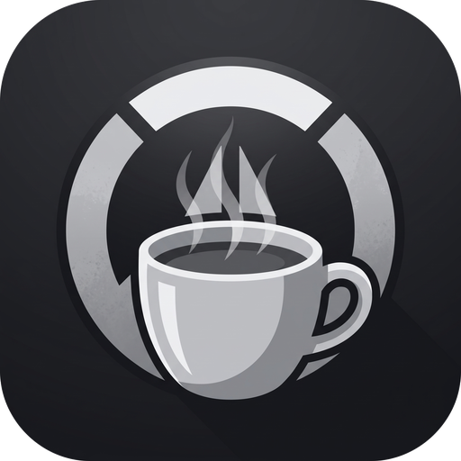

<p align="center">
  
</p>

<h1 align="center">OverTilt</h1>

<p align="center">
  Compañero de sesión para Overwatch: detecta victorias y derrotas por OCR y te avisa cuando necesitas un descanso.
</p>

## ¿Qué hace?

- Detecta los banners de **VICTORIA** y **DERROTA** con captura de pantalla + OCR (Tesseract).
- Cuenta victorias, derrotas y racha actual de derrotas.
- Muestra un aviso y un sonido al alcanzar el límite de derrotas consecutivas que elijas.
- Overlay flotante siempre visible con las estadísticas de la sesión.
- Vista del texto que lee el OCR para depurar la detección.
- Interfaz de escritorio (PySide6) y modo CLI con vista previa.

## Requisitos

| Requisito | Detalle |
|---|---|
| Sistema | Windows 10/11 |
| Python | 3.10 o superior |
| Tesseract OCR | 5.x ([instalador UB Mannheim](https://github.com/UB-Mannheim/tesseract/wiki)) |
| Juego | Overwatch en 16:9, preferentemente 1920×1080 |
| Escalado de Windows | 100 % (la región se calibra en píxeles) |

El proyecto busca Tesseract en `PATH`, en `C:\Program Files\Tesseract-OCR` y en `%LOCALAPPDATA%\Programs\Tesseract-OCR`. Si lo tienes en otra ruta:

```powershell
$env:TESSERACT_CMD = "D:\ruta\a\tesseract.exe"
```

## Instalación

```powershell
git clone https://github.com/IgnacioG32/OverTilt.git
cd OverTilt
python -m venv .venv
.\.venv\Scripts\Activate.ps1
pip install -r requirements.txt
```

## Uso

Interfaz gráfica:

```powershell
python app.py
```

CLI con vista previa de la región capturada:

```powershell
python Overtilt.py
```

Opciones útiles:

```powershell
python Overtilt.py --limite-derrotas 5            # aviso tras 5 derrotas seguidas
python Overtilt.py --sin-vista-previa             # solo consola, sin ventanas de OpenCV
python Overtilt.py --depurar-ocr                  # imprime lo que lee Tesseract
python Overtilt.py --imagen-prueba image_victoria.png
```

## Calibración

La región de captura está calibrada para 1920×1080 (`left=669`, `top=431`, ancho `621`, alto `214`) y se escala según el tamaño del monitor. Si tu HUD o resolución hacen que no se detecte nada:

1. Ejecuta `python detector.py`.
2. Arrastra un recuadro sobre el texto VICTORIA / DERROTA y pulsa `C`.
3. Copia las coordenadas que imprime la consola en `crear_region()` de `Overtilt.py`.

## Estructura

```text
app.py          # Aplicación de escritorio (PySide6)
Overtilt.py     # Núcleo de detección y CLI (tkinter/OpenCV)
detector.py     # Herramienta de calibración de la región
tools/          # Utilidades (generación de sonidos)
assets/         # Icono y efectos de sonido
```

## Limitaciones conocidas

- Solo Windows y monitor principal.
- Tesseract debe instalarse por separado.
- Pensado para 16:9; en ultrawide o con escalado DPI alto puede requerir recalibración.
- Consumo de CPU moderado mientras la detección está activa (dos pasadas de OCR por lectura).

## Aviso

Proyecto personal, no oficial ni afiliado a Blizzard. Overwatch es una marca de Blizzard Entertainment.

## Licencia

Todavía no hay una licencia definida para este proyecto.
